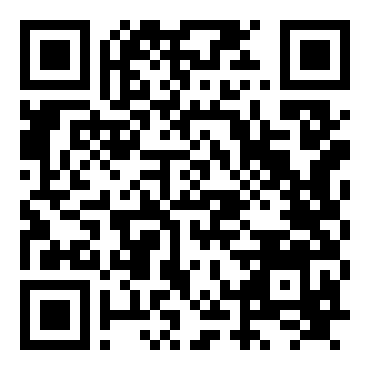
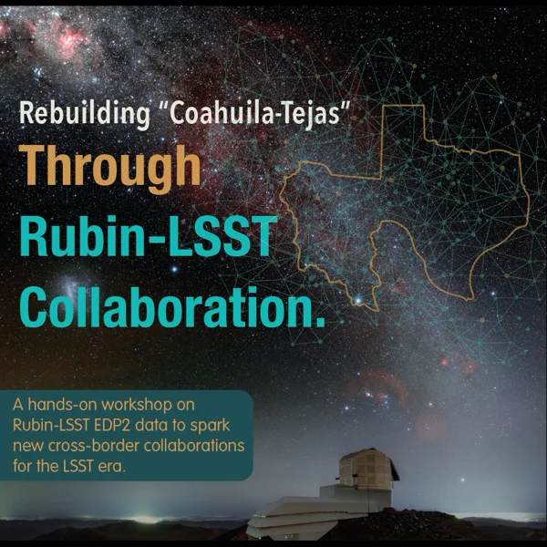

# HATS/LSDB at the Coahuila y Tejas Meeting, November 9-12, 2026

## Cross-matching, light-curve analysis, and sharing results of Rubin DP2 catalogs with LSDB

Scan the QR code or go to https://github.com/hombit/CoahuilaTejas2026-tutorial-lsdb to open this repository.

 

Demos prepared for "Rebuilding 'Coahuila-Tejas' Through Rubin-LSST Collaboration", a hands-on workshop on Rubin DP2 data to spark new collaborations between Mexican and Texan institutions, held November 9-12 2026, University of Guanajuato, León, Mexico.

The notebooks showcase working with HATS-partitioned survey catalogs via [LSDB](https://lsdb.io) ([docs](https://docs.lsdb.io)), and time domain analysis with `nested-pandas` ([docs](https://nested-pandas.readthedocs.io/en/latest/)) and `light-curve` ([docs](https://light-curve.snad.space)).
The focus is on how Rubin data rights holders (DRHs) and non-DRHs can work together: DRHs run the analysis on Rubin data and share only derived products that are safe to share.

### When and where:

More information at this [link](https://sites.google.com/view/coahuila-y-tejas-meeting/home), see the [agenda](https://sites.google.com/view/coahuila-y-tejas-meeting/agenda) for the schedule.

The LSDB tutorial is on **Tuesday, November 10, 09:45–11:00** local time.

### How to ask for help

* Konstantin (Kostya) Malanchev: <malanchev@cmu.edu>
* GitHub issues for LSDB: https://github.com/astronomy-commons/lsdb/issues
* LSST Discovery Alliance Slack channel
  * Feel free to use [`#lincc-frameworks-lsdb`](https://discovery-alliance.slack.com/archives/C04610PQW9F) channel on LSST-DA slack for any questions, bugs, or problems!
  * For Rubin specific questions, please also check the community forum at https://community.lsst.org/
* "Contact us" documentation page for LSDB: https://docs.lsdb.io/en/latest/contact.html

### Main references

* **TODO**: [Slide deck]()
* Rubin data rights
  * [Rubin Observatory Data Policy (RDO-013)](https://ls.st/rdo-013)
  * [Slides on Rubin data rights and working with non-DRHs](https://docs.google.com/presentation/d/1ZF2JsncJvEmcDK9V7Mg5dsFag-08MZQP_2H3ncPi29c/edit?usp=sharing)
* LSDB ([Main page](https://lsdb.io))([LSDB catalogs](https://data.lsdb.io))([on GitHub](https://github.com/astronomy-commons/lsdb))([documentation](https://lsdb.readthedocs.io/en/latest/))
  * [Accessing Rubin DP2 with LSDB](https://lsdb.io/dp2)
  * [LSDB tutorials](https://docs.lsdb.io/en/latest/tutorials.html)
  * [LSDB field guide](https://astronomy-commons.github.io/lsdb-field-guide/)
  * [Working with Rubin data section in LSDB documentation](https://docs.lsdb.io/en/latest/tutorial_toc/toc_rubin.html)
  * Rubin DP2 photo-z tutorials with LSDB: [access and visualization](https://dp2.lsst.io/tutorials/notebook/310/notebook-310-1.html), [analysis](https://dp2.lsst.io/tutorials/notebook/310/notebook-310-2.html)
* HATS ([on GitHub](https://github.com/astronomy-commons/hats))([documentation](https://hats.readthedocs.io/en/stable/))
* nested-pandas ([on GitHub](https://github.com/lincc-frameworks/nested-pandas))([documentation](https://nested-pandas.readthedocs.io/en/stable/))
* light-curve ([on GitHub](https://github.com/light-curve/light-curve-python))([documentation](https://light-curve.snad.space))

## Rubin data rights

Rubin data are proprietary: only data rights holders (DRHs) may access them.
Non-DRHs can fully take part in designing the analysis, but cannot interact with Rubin data directly, except for the public [alert data distributed by brokers](https://rubinobservatory.org/for-scientists/data-products/alerts-and-brokers).
The alerts are also available as a [HATS catalog](https://data.lsdb.io/Rubin/Alert_Archive), but we don't use alerts in these tutorials.
Please read the [Rubin Observatory Data Policy](https://ls.st/rdo-013) and the [slides on data rights](https://docs.google.com/presentation/d/1ZF2JsncJvEmcDK9V7Mg5dsFag-08MZQP_2H3ncPi29c/edit?usp=sharing) before the workshop.

If you are a DRH running these notebooks on the [Rubin Science Platform](https://data.lsst.cloud) (RSP) and planning to share your results with non-DRHs, here is some advice on what to avoid:

* Printing or plotting original Rubin data, e.g. with `.head()` or by displaying `.compute()` results.
  Aggregated plots, such as 2D histograms of colors, are usually fine, while plots of individual objects, such as light curves, are not.
* Saving the original tables, e.g. with `.write_catalog()`.
* Sharing original Rubin columns other than object IDs. Note that even `_healpix_29` is not safe to share: it is a high-resolution HEALPix index, which can be converted back to the sky coordinates.

And here is what you can do instead, sharing only derived products which can't be used to reverse-engineer the original values:

* Aggregations, e.g. 2D histograms of colors ([Notebook 1a](/tutorials/Notebook_1a_Intro.ipynb), [1b](/tutorials/Notebook_1b_ColorMagnitude.ipynb)).
* Anonymization, e.g. replacing Rubin values with coarse flags or categories, such as whether they agree with an external catalog ([Notebook 2a](/tutorials/Notebook_2a_Crossmatch.ipynb)).
* Feature extraction, e.g. light-curve features ([Notebook 3a](/tutorials/Notebook_3a_LightCurveFeatures.ipynb)).
* Similarity search, sharing IDs, cosine distances, and light-curve embeddings of the nearest neighbours ([Notebook 3b](/tutorials/Notebook_3b_SimilaritySearch.ipynb)).
* Saving these derived products as plain Parquet files with `.to_parquet()`, after dropping `_healpix_29` ([Notebook 3a](/tutorials/Notebook_3a_LightCurveFeatures.ipynb)).
  A HATS catalog always has `_healpix_29`, so it can be shared only when `_healpix_29` comes from public coordinates, e.g. when a public catalog is the left one in a cross-match with Rubin data ([Notebook 2a](/tutorials/Notebook_2a_Crossmatch.ipynb)).

## What is LSDB?

LSDB is a Python framework for working with large (and not so large) astronomical catalogs.
Its main strength is the ability to work with catalogs that are too large to fit in memory, by using lazy loading and Dask for parallel processing.
It also provides a convenient interface for cross-matching catalogs, and for working with time-domain and spectral data.

### But what is HATS?

HATS (Hierarchical Astronomical Tiling System) is a storage format for astronomical catalogs that is designed to enable efficient bulk-processing of large catalogs,
and optimize crossmatching, spatial queries, and table column selection.

Each Parquet file has the same structure, and corresponds to a single HEALpix tile on the sky.
For example, here is the sky map for the HATS Gaia DR3 catalog, each rectangle corresponds to a single Parquet file, and the color shows mean parallax.

## Getting Started

All notebooks except 2b use Rubin DP2, so they can be run by DRHs only, on a platform hosting DP2 HATS catalogs, see [lsdb.io/dp2](https://lsdb.io/dp2). Notebook 2b uses only the shareable catalog saved in Notebook 2a.
Non-DRHs can still read the notebooks, discuss the analysis, and work with the derived products shared by DRHs, using any Jupyter environment with `lsdb` and `s3fs` installed.
To not saturate the workshop WiFi, we recommend using a remote environment, such as [NASA Fornax](https://science.nasa.gov/astrophysics/programs/physcon/fornax/), or [NOIRLab Astro Data Lab](https://datalab.noirlab.edu/).

### On Rubin Science Platform

Make sure that you have access to the [Rubin Science Platform](https://data.lsst.cloud) and follow the instructions at [lsdb.io/dp2](https://lsdb.io/dp2).
When starting a Notebook server, select the **latest weekly** version of the Rubin Science Pipelines. LSDB is pre-installed there, so no other setup is needed.

### On other platforms hosting DP2

See [lsdb.io/dp2](https://lsdb.io/dp2) for the list of other platforms hosting DP2 HATS catalogs and the instructions.

## [Notebooks](/tutorials/)

### [Notebook 1a](/tutorials/Notebook_1a_Intro.ipynb)

In this notebook, we will learn how to:

- Set up a Dask client
- Load the Rubin DP2 Object catalog (lazily) and select columns
- Understand HATS partitioning
- Select a region on the sky
- Select "bright" stars and plot a color-color diagram

#### [Homework](/tutorials/Notebook_1b_ColorMagnitude.ipynb)

Task: plot a color-magnitude diagram of the globular cluster Palomar 12.

1. Select a small cone around the cluster
2. Select point sources with good photometry
3. Plot a color-magnitude diagram

### [Notebook 2a](/tutorials/Notebook_2a_Crossmatch.ipynb)

In this notebook, we will learn how to:

- Load the [DESI Legacy Survey DR11 South](https://data.lsdb.io/DESI/Legacy_Survey_DR11.0_South) catalog
- Cross-match it with the Rubin DP2 photo-z catalog
- Flag objects where the Legacy Survey and Rubin photo-z agree
- Save the flags as a HATS catalog, which can be shared with non-DRHs

#### [Homework](/tutorials/Notebook_2b_PhotoZSkyMap.ipynb)

Task: plot the fraction of objects with matching Legacy Survey and DP2 photo-z as a sky map.

1. Open the catalog saved in Notebook 2a
2. Compute the fraction of matching photo-z in each HEALPix pixel
3. Plot it as a sky map

### [Notebook 3a](/tutorials/Notebook_3a_LightCurveFeatures.ipynb)

In this notebook, we will learn how to:

- Load the Rubin DP2 DiaObject catalog with nested light curves of forced photometry at the DiaObject positions
- Cross-match it with the VSX catalog of known variable stars
- Extract light-curve features in parallel with the `light-curve` package
- Save the features to a Parquet file, which can be shared with non-DRHs
- Train a classifier to separate eclipsing binaries from long-period variables, using the shared features only

Use case: a DRH shares light-curve features of known variable stars, so non-DRHs can develop and train machine-learning models without access to the Rubin data.

#### [Homework](/tutorials/Notebook_3b_SimilaritySearch.ipynb)

Task: a non-DRH colleague gives you the coordinates of an object and asks you to find DP2 objects similar to it.

1. Find the DP2 object at these coordinates
2. Embed DP2 light curves in a small sky region
3. Find the nearest neighbours of the given object
4. Share back their object IDs, cosine distances, and embeddings

The example object is [AT2025tsz](https://www.wis-tns.org/object/2025tsz), a SN Ia candidate selected with the [TNS EDP2 explorer](https://trivialtz.github.io/tns-edp2-explorer/).

## Acknowledgements

This project is supported by Schmidt Sciences.

This project is based upon work supported by the National Science Foundation under Grant No. AST-2003196.
